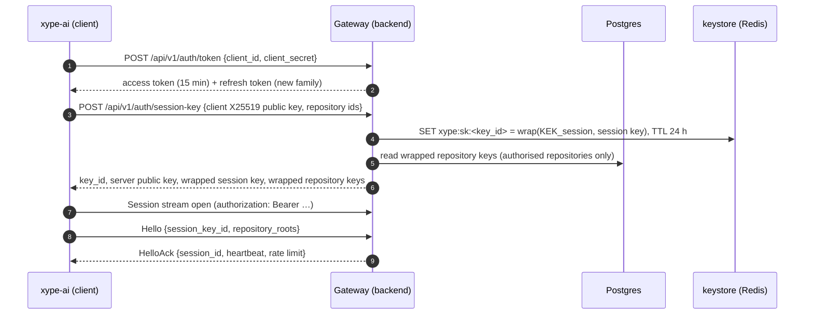
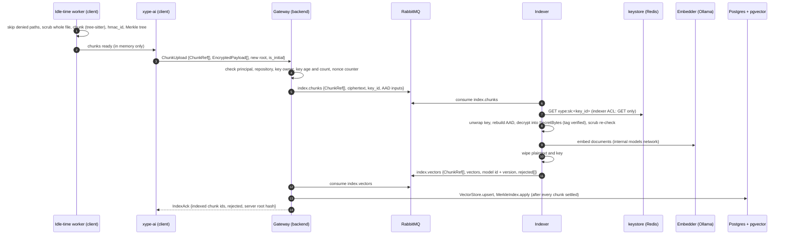
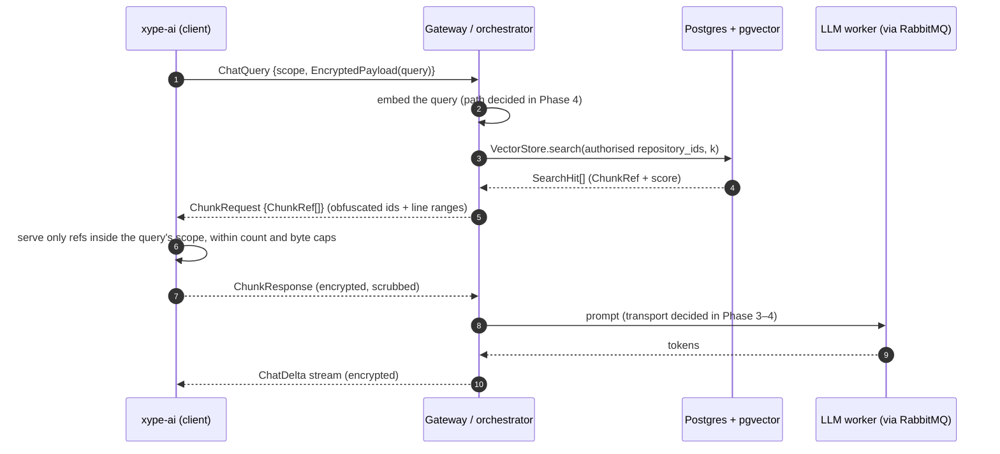

# Flow: context awareness (initial index and selective fetch)

Brief §3.5. Decisions: ADR-0013, ADR-0014, ADR-0015, ADR-0016, ADR-0019, ADR-0020. Implemented in Phase 2 (indexing); the query part follows in Phase 4.

Every arrow that carries code, paths or queries carries an `EncryptedPayload`. Everything else is an id, an HMAC, a line range, a size or an enum. The gateway authorizes every `repository_id` against the caller's team on every message.

## Session setup

## Initial index

## Query and selective fetch (Phase 4, outline)

Open questions for Phases 3–4:
- how the query reaches the embedder, given that the backend is not on the `models` network;
- how prompts travel to the LLM worker over RabbitMQ without plaintext in the broker.
